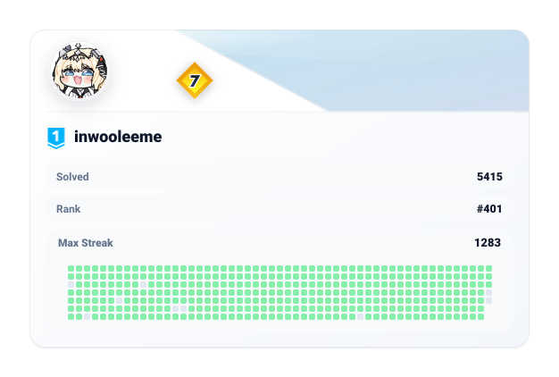

  

## 🛠 Tech Stack
 
| 분야 | 기술 |
|:---:|:---|
| **Languages** |      |
| **AI · Agent** |    |
| **Backend** |   |
| **Frontend** |     |
| **Database** |   |
| **DevOps · Tools** |     |

## 🏆 Awards
 
| 일자 | 대회 | 결과 |
|:---:|:---|:---:|
| 2025.10 | ICPC 전북대학교 예선 경시대회 | **금상** |
| 2025.06 | 한국정보기술학회 하계종합학술대회 대학생 논문경진대회 「MCP 기반 PC용 개인 음성 비서 시스템 구축 방안」 | **우수논문상** |
| 2024.11 | ICPC 전북대학교 예선 경시대회 | **금상** |
| 2024.10 | 전남대학교 SW중심대학 제7회 SW프로그래밍 경진대회 (호남·제주권) | **장려상** |
 
## 🚀 Problem Setting
 
| 연도 | 대회 | 출제 문제 |
|:---:|:---|:---|
| 2026 | 전북대학교 알고리즘 경진대회 | 출제 및 운영 |
| 2025 | 전북대학교 알고리즘 경진대회 | F. 성범이의 검증 시험에 답하라! |
| 2024 | 전북대학교 알고리즘 경진대회 | A. 강아지 산책 E. 문자열을 다루는 문제가 문제다 |
 
## 👥 Contests
 
| 연도 | 대회 | 순위 |
|:---:|:---|:---:|
| 2025 | UCPC 예선 | 135th |
| 2024 | UCPC 예선 | 132nd |
| 2022 | UCPC 예선 | 240th |
 
## 🎓 Certificates
 
| 자격증 | 발급 기관 | 취득일 |
|:---|:---|:---:|
| 데이터분석 준전문가 (ADsP) | 한국데이터산업진흥원 | 2026.03 |
| 정보처리기사 | 한국산업인력공단 | 2025.12 |
| 한국사능력검정시험 1급 | 국사편찬위원회 | 2025.10 |
