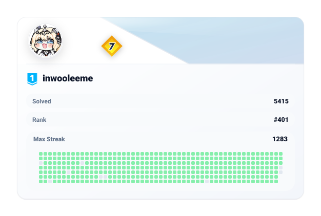

<h1 align="center">InwooLeeme</h1>

  <strong>AI Agents · Algorithms</strong>

  문제를 풀고, 만들고, 기록합니다.

[Blog](https://inwooleeme.vercel.app/) · [GitHub](https://github.com/InwooLeeme) · [solved.ac](https://solved.ac/inwooleeme)

[Projects](#selected-projects) · [Algorithms](#algorithms--problem-setting) · [Research](#research) · [Activity](#github-activity)

---

## Profile

- **AI Agents:** LangGraph·AutoGen·MCP 기반 AI 에이전트 설계 및 개발
- **Algorithms:** 알고리즘 문제 해결·출제 및 대회 운영
- **DevOps:** Docker Compose 및 GitHub Actions 기반 CI/CD 담당
- **Education:** 전북대학교 소프트웨어공학과 졸업

## Selected Projects

### MCP Assistant

음성 명령으로 음악 재생과 PC 애플리케이션 실행을 수행하는 개인 비서입니다.

- **담당:** MCP 서버·AI 에이전트·프론트엔드 구현 및 논문 작성
- **개선:** 하나의 LLM이 의도 분석과 실행 계획 수립을 함께 담당하도록 구조 변경
- **결과:** 도구 호출을 제외한 명령당 LLM 호출 **3회 → 1회**
- **연구 당시:** AutoGen · MCP · FastAPI · React · Electron
- **후속 개발:** Electron·React 클라이언트를 Tauri·Next.js로 전환

[Source Code](https://github.com/InwooLeeme/mcp-assistant) · [Paper](https://www.dbpia.co.kr/journal/articleDetail?nodeId=NODE12288718)

---

### Molecular Toxicity Prediction

분자 구조와 물성 정보로 독성 여부를 예측한 **6인 팀 프로젝트**입니다.

- **공동 수행:** EDA 및 분석 발표 자료 작성
- **개인 담당:** 분자 특성·모델 비교 실험, 최종 학습·예측 노트북 구현
- **검증:** 동일 모델 입력 중복 점검 및 분자 골격을 고려한 학습·검증 데이터 분리
- **비교:** Random Forest · ExtraTrees · XGBoost · LightGBM
- **최종 모델:** Random Forest·ExtraTrees 앙상블
- **성과:** 최종 앙상블 모델로 **F1 0.8483**

## Algorithms & Problem Setting

### SKOJ / 약 350문제 출제

SKALA 학생을 위한 온라인 알고리즘 문제 채점 사이트에서 **문제 기획·지문 작성·정답 코드 구현·테스트 데이터 제작·검수**를 담당했습니다.

[Visit SKOJ](https://skoj.site/)

### Contest Problem Setting

| 연도 | 전북대학교 알고리즘 경진대회 |
|:---:|:---|
| 2026 | 출제 및 운영 |
| 2025 | F. 성범이의 검증 시험에 답하라! 출제 |
| 2024 | A. 강아지 산책 / E. 문자열을 다루는 문제가 문제다 출제 |

### Awards

| 연도 | 대회 | 결과 | 구분 |
|:---:|:---|:---|:---:|
| 2025 | ICPC 전북대학교 예선 경시대회 | **금상** | 3인 팀 |
| 2024 | ICPC 전북대학교 예선 경시대회 | **금상** | 3인 팀 |
| 2024 | 전남대학교 SW중심대학 제7회 SW프로그래밍 경진대회 | **장려상** | 개인 |

UCPC 예선 기록

| 연도 | 순위 |
|:---:|:---:|
| 2025 | 135위 |
| 2024 | 132위 |
| 2022 | 240위 |

## Research

**MCP 기반 PC용 개인 음성 비서 시스템 구축 방안**

- 한국정보기술학회 2025년도 하계종합학술대회 및 대학생논문경진대회 · 2025.06
- **한국정보기술학회 대학생 논문경진대회 우수논문상**
- MCP 서버·AI 에이전트·프론트엔드 구현 및 논문 작성

[Read Paper](https://www.dbpia.co.kr/journal/articleDetail?nodeId=NODE12288718)

## Tech Stack

| 분야 | 기술 |
|:---:|:---|
| **Languages** |  |
| **Backend** |  |
| **Frontend** |  |
| **Database** |  |
| **DevOps · Tools** |  |
| **AI · Agent** |    |

## More Projects

### NASDAQ Pattern Chart

나스닥 주식 데이터를 차트로 시각화하는 프로젝트입니다.

- **담당:** React 기반 프론트엔드 개발, 차트 시각화 및 UI 디자인

[Source Code](https://github.com/InwooLeeme/database-nasdaq)

### InwooLeeme.dev

알고리즘 풀이와 개발 경험을 기록하는 Next.js 기반 개인 기술 블로그입니다.

[Visit Blog](https://inwooleeme.vercel.app/)

## GitHub Activity

  

## Certificates

| 자격증 | 발급 기관 | 취득 |
|:---|:---|:---:|
| 데이터분석 준전문가 ADsP | 한국데이터산업진흥원 | 2026.03 |
| 정보처리기사 | 한국산업인력공단 | 2025.12 |
| 한국사능력검정시험 1급 | 국사편찬위원회 | 2025.10 |
